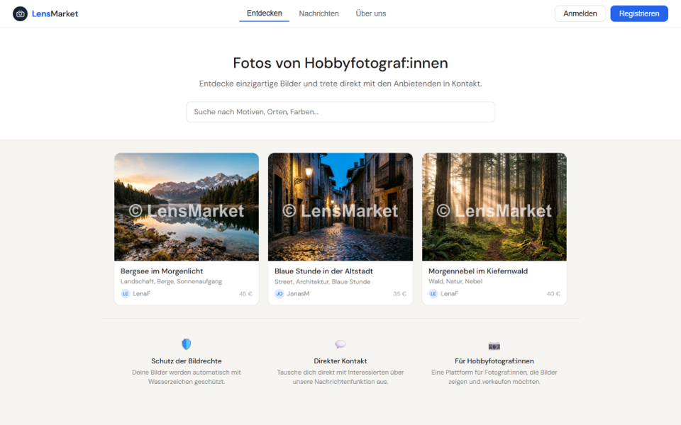
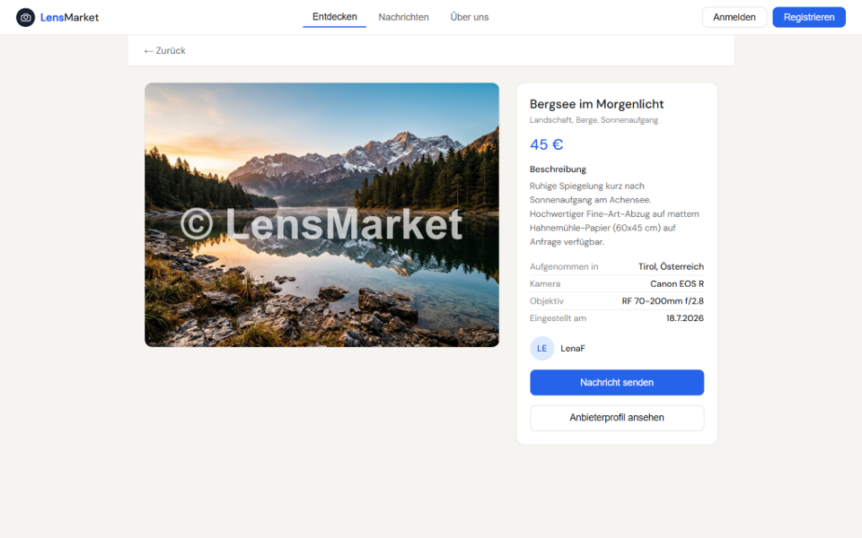
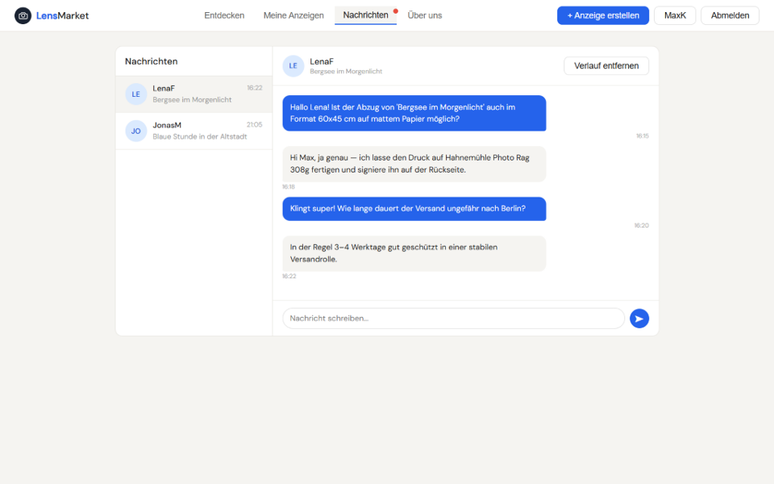
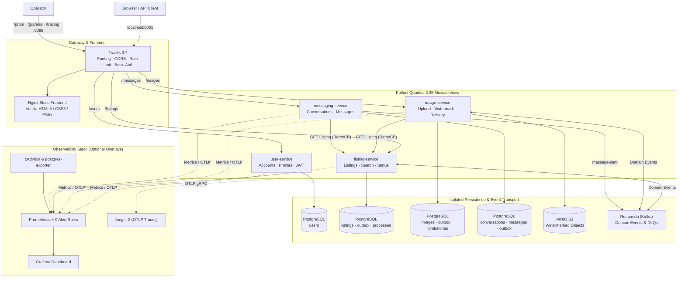

<div align="center">
  <h1>LensMarket</h1>

  <p>
    <strong>Cloud-native photography classifieds marketplace built with Kotlin, Quarkus, PostgreSQL, Redpanda, MinIO, Traefik, and full observability.</strong>
  </p>

  <p>
    
    
    
    
    
    
    
    <a href="LICENSE"></a>
  </p>
</div>

---

## Overview

**LensMarket** is a cloud-native classifieds marketplace MVP for hobby photographers. It implements an end-to-end microservices workflow spanning user registration and stateless JWT authentication, searchable photo listings, server-side watermarked image uploads, and direct buyer–seller messaging behind a Traefik API gateway. Checkout, payments, email verification, and password reset are intentionally out of scope to keep the focus on distributed systems architecture.

Each domain service owns its dedicated PostgreSQL database and Flyway migrations (no cross-service foreign keys or shared tables), enforces Clean Architecture boundaries automatically via a custom Gradle `architectureCheck` task, uses a **Transactional Outbox** with idempotent Kafka consumers and dead-letter queues for asynchronous domain events, and ships with a complete local observability stack (**Prometheus**, **Grafana**, **Jaeger 2**, and **cAdvisor**).

---

## Screenshots

<div align="center">
  <table>
    <tr>
      <td align="center"><strong>Marketplace Gallery</strong></td>
      <td align="center"><strong>Listing Detail &amp; Watermark</strong></td>
      <td align="center"><strong>Buyer–Seller Messaging</strong></td>
    </tr>
    <tr>
      <td></td>
      <td></td>
      <td></td>
    </tr>
  </table>
</div>

---

## Key Features

- **Accounts & Stateless JWT Authentication (`user-service`)**: Registration, login, stateless client-side logout, and public/private user profiles. Issues HS256 JWTs (`jose4j`) verified locally by every service (signature, HS256 allowlist, `iss`, `aud`, timestamps, and required claims). Authorization relies strictly on verified identity, ownership, and conversation participation—the self-editable `role` field grants no extra privileges.
- **Listings, Search & Status Machine (`listing-service`)**: Full listing CRUD, search/filtering/pagination (tags, location, price range, owner), soft deletion, strict visibility separation (`GET /listings` serves only `ACTIVE`; authenticated `/listings/mine` exposes `PAUSED`/`SOLD`), terminal `SOLD` state enforcement, and eventual-consistency image ID projection via `image-watermarked` events.
- **Watermarked Image Pipeline & S3 Storage (`image-service`)**: Multipart uploads validating file size (up to `11M`), MIME type, and decodable image content off the event loop, automatic scaling (`max 1600px`) and repeated server-side `© LensMarket` watermarking (`0.7` opacity) via `Thumbnailator`, watermark-only persistence in MinIO, compensating MinIO deletion on DB failures, and periodic non-destructive orphaned-object scanning (`lensmarket_storage_orphaned_objects`).
- **Participant-Scoped Messaging & Idempotency (`messaging-service`)**: Per-listing buyer–seller conversations blocking self-contact, per-participant soft removal transitioning conversations to `CLOSED` once both sides remove them, optional `Idempotency-Key` header (up to 64 characters) returning the original message (`200` vs. `201`) on retries, and `message-sent` domain events.
- **Automated Clean Architecture Enforcement**: Every service separates a framework-free `:application` module (domain models, `suspend` ports, use cases) from an outer Quarkus adapter module (HTTP resources, Panache/PostgreSQL, Kafka, MinIO, Micrometer). The `architectureCheck` Gradle task fails the build on forbidden framework imports, production dependencies in `:application`, or resources/consumers bypassing use cases.
- **Transactional Outbox, Fault Tolerance & DLQ**: Atomic commits of domain data and `outbox_events` in local PostgreSQL transactions with background exponential-backoff relays (`1–64 s`), at-least-once Redpanda delivery, `processed_events` deduplication and `deleted_listings` tombstones, dead-letter queues (`image-watermarked-dlq`, `listing-deleted-dlq`), and fail-closed synchronous `GET` lookups with timeouts, bounded retries, and circuit breakers (`503` / `504`).
- **Observability, OpenAPI 3.1 & Load Testing**: Prometheus DNS service discovery with 9 alert rules, provisioned Grafana dashboard (`cAdvisor` + `postgres-exporter` + service metrics), Jaeger 2 OpenTelemetry tracing, Traefik 3.7 gateway (CORS, login/register rate limiting, Basic Auth dashboard), code-generated OpenAPI 3.1 contract verification (`validateOpenApi`), and k6 horizontal scaling benchmarks (`load-tests/`).

---

## Architecture

LensMarket routes all external traffic through **Traefik** on port `8081` to a static Nginx frontend and four independently buildable Kotlin/Quarkus microservices, each backed by its own PostgreSQL instance and connected via **Redpanda** for domain events:



### Service Overview

| Component | Route / Port | Responsibility | Persistence |
| --- | --- | --- | --- |
| `user-service` | `/users` | Accounts, password hashing, HS256 JWT issuance, public/private profiles | PostgreSQL (`users`) |
| `listing-service` | `/listings` | Listing CRUD, filtered search, status lifecycle, image ID projection | PostgreSQL (`listings`) |
| `image-service` | `/images` | Multipart validation, resizing, server-side watermarking, image delivery, orphan scan | PostgreSQL (`images`), MinIO |
| `messaging-service` | `/messages` | Listing-scoped conversations, idempotent message delivery, soft removal | PostgreSQL (`messages`) |
| `frontend` | `/` | Zero-build static marketplace UI (German UI) served via Nginx | — |
| `gateway` (Traefik) | `:8081` / `:8088` | Reverse proxy, CORS (`Idempotency-Key`), login/register rate limiting, protected dashboard | — |
| `redpanda` | Internal `:9092` | Kafka-compatible broker for domain events and dead-letter topics | `redpanda-data` volume |
| Observability overlays | `/prom`, `/grafana`, `/tracing` | Prometheus metrics & alerts, Grafana dashboard, Jaeger 2 traces, cAdvisor, Postgres exporter | Metric/dashboard volumes |

### Clean Architecture & Event Flow

- **Enforced Layer Direction**: Outer Quarkus adapters (`resources/`, `data/`, `events/`, `auth/`, `metrics/`, `composition/`) depend on the inner framework-free `:application` module (`domain/model`, `domain/port`, `domain/usecase`), never the reverse.
- **Synchronous vs. Asynchronous Boundaries**: Cross-service synchronous calls are limited to safe, fail-closed `GET` lookups against `listing-service` (`1s` connect / `2s` request / `2.5s` fault-tolerance timeout, max 2 retries, circuit breaker). Cross-service state changes propagate asynchronously via Transactional Outbox over Redpanda (`listing-created`, `listing-status-changed`, `listing-deleted`, `image-uploaded`, `image-watermarked`, `message-sent`).

---

## Tech Stack

| Layer | Technology | Version / Details |
| --- | --- | --- |
| Language & Runtime | Kotlin / JVM (`Eclipse Temurin`) | Kotlin `2.3.21` / Java `17` |
| Microservice Framework | Quarkus (`REST`, `Hibernate Reactive Panache`, `SmallRye OpenAPI / Health / Fault Tolerance`) | `3.35.3` |
| Build & Verification | Gradle Wrapper, Dokka, JaCoCo, custom `architectureCheck` & `validateOpenApi` | Gradle `9.4.0` / Dokka `2.2.0` / JaCoCo `0.8.15` |
| Authentication | `jose4j` (stateless HS256 JWT) | `0.9.6` |
| Databases & Migrations | PostgreSQL + Flyway (4 isolated service databases) | PostgreSQL `16.13` |
| Event Streaming | Redpanda (Kafka-compatible) + SmallRye Reactive Messaging | Redpanda `v24.3.9` |
| Object Storage & Imaging | MinIO S3 + MinIO Java SDK + Thumbnailator | MinIO `RELEASE.2025-09-07` / SDK `8.5.17` / `0.4.20` |
| API Gateway & Frontend | Traefik + Vanilla HTML5 / CSS3 / ES6+ on Nginx | Traefik `3.7.0` / Nginx `1.30.1-alpine` |
| Observability | Prometheus, Grafana, Jaeger 2 (OpenTelemetry OTLP), cAdvisor, `postgres-exporter` | `v3.12.0` / `13.0.2` / `2.19.0` / `v0.55.1` / `v0.17.1` |
| Testing & Load Testing | JUnit 5, REST Assured, Quarkus Dev Services / Testcontainers, SmallRye In-Memory, k6 + Python | `load-tests/analyze.py` |

---

## Project Structure

```text
lensmarket/
├── .github/workflows/ci.yml     # GitHub Actions CI (tests, architectureCheck, quarkusBuild, validateOpenApi)
├── user-service/                # Accounts, JWT auth & profiles (:application + Quarkus module + Flyway)
├── listing-service/             # Listings, filtered search, status & image projection
├── image-service/               # Multipart upload, Thumbnailator watermark, MinIO & orphan detector
├── messaging-service/           # Participant-scoped conversations, idempotent messages & Outbox
├── system-tests/                # End-to-end REST Assured suite against running Docker Compose stack
├── load-tests/                  # k6 load/breakpoint tests & Python latency/scaling analyzer
├── frontend/                    # Zero-build static Vanilla JS marketplace UI (Nginx)
├── monitoring/                  # Prometheus config/alerts, Grafana dashboard, Jaeger & cAdvisor overlays
├── docs/                        # Detailed technical documentation (German), screenshots & OpenAPI 3.1 contracts
│   ├── openapi/                 # Code-generated OpenAPI 3.1 JSON contracts for all 4 services
│   └── screenshots/             # UI screenshots for the repository overview
├── .env.example                 # Local environment configuration template (copy to .env)
├── docker-compose.yml           # Core stack (Traefik, frontend, 4 services, 4 PostgreSQL DBs, Redpanda, MinIO)
├── dc.ps1                       # Windows PowerShell helper combining base stack + observability overlays
├── build.gradle.kts             # Root Gradle build (Dokka, JaCoCo, architectureCheck, validateOpenApi)
├── settings.gradle.kts          # Multi-module project setup (8 service/application modules + system-tests)
└── LICENSE                      # Copyright & All Rights Reserved notice
```

Each service also bundles its own `settings.gradle.kts`, Gradle wrapper, Flyway migrations, and multi-stage `Dockerfile.jvm`, allowing both aggregated root builds and isolated per-service builds.

---

## Getting Started

### Prerequisites

- **JDK 17** (no global Gradle installation required—builds use the bundled Gradle wrapper)
- **Docker Engine** with **Docker Compose v2**
- **PowerShell** on Windows (for the [`dc.ps1`](dc.ps1) helper)
- Optional for load benchmarks: **k6** and **Python 3**

### 1. Clone & Configure `.env`

```shell
git clone https://github.com/Paul1708/lensmarket.git
cd lensmarket
```

Copy [`.env.example`](.env.example) to `.env` (gitignored) in the repository root—[`docker-compose.yml`](docker-compose.yml) intentionally fails fast without secrets:

**Windows (PowerShell):**

```powershell
Copy-Item .env.example .env
```

**macOS / Linux:**

```shell
cp .env.example .env
```

Replace every `replace-*` placeholder in `.env` before starting: `LENSMARKET_JWT_SECRET` requires at least 32 random bytes, and `TRAEFIK_DASHBOARD_USERS` expects a bcrypt `htpasswd` entry.

### 2. Start & Stop the Full Stack

**Windows (PowerShell):**

```powershell
# Build and start base stack + Prometheus, Grafana, cAdvisor & Jaeger
powershell -NoProfile -ExecutionPolicy Bypass -File .\dc.ps1 `
  up -d --build --wait --wait-timeout 180

# Verify container health
powershell -NoProfile -ExecutionPolicy Bypass -File .\dc.ps1 ps

# Stop gracefully (preserves persistent volumes)
powershell -NoProfile -ExecutionPolicy Bypass -File .\dc.ps1 down --remove-orphans
```

**macOS / Linux:**

```shell
docker compose \
  -f docker-compose.yml \
  -f monitoring/docker-compose-metrics.yml \
  -f monitoring/docker-compose-metrics-ui.yml \
  -f monitoring/docker-compose-tracing.yml \
  up -d --build --wait --wait-timeout 180
```

Use the same `-f` file list with `down --remove-orphans` to stop the stack.

### 3. Local Endpoints

| Purpose | URL |
| --- | --- |
| Frontend & API Gateway | `http://localhost:8081/` |
| User Service Health | `http://localhost:8081/users/health` |
| Listing Service Health | `http://localhost:8081/listings/health` |
| Image Service Health | `http://localhost:8081/images/health` |
| Messaging Service Health | `http://localhost:8081/messages/health` |
| Prometheus (Targets & Alerts) | `http://localhost:8081/prom/` |
| Grafana (Provisioned Dashboard) | `http://localhost:8081/grafana/` |
| Jaeger 2 (Distributed Tracing) | `http://localhost:8081/tracing/` |
| Traefik Dashboard (Basic Auth) | `http://localhost:8088/dashboard/` |

---

## Testing & Verification

The test pyramid combines **39** framework-free `:application` unit tests and **33** Quarkus/PostgreSQL Testcontainers integration & adapter tests (**72** service tests across all four services), **1** end-to-end Docker Compose system test (`:system-tests`), static Clean Architecture (`architectureCheck`) and OpenAPI 3.1 contract verification (`validateOpenApi`), aggregated JaCoCo coverage, and standalone k6 load & horizontal scaling benchmarks.

### Full Build, Test & Contract Verification

**Windows (PowerShell):**

```powershell
.\gradlew.bat clean test architectureCheck --no-daemon
.\gradlew.bat :user-service:quarkusBuild --no-daemon
.\gradlew.bat :listing-service:quarkusBuild --no-daemon
.\gradlew.bat :image-service:quarkusBuild --no-daemon
.\gradlew.bat :messaging-service:quarkusBuild --no-daemon
.\gradlew.bat validateOpenApi jacocoAggregatedReport --no-daemon
```

**macOS / Linux:**

```shell
./gradlew clean test architectureCheck --no-daemon
./gradlew :user-service:quarkusBuild --no-daemon
./gradlew :listing-service:quarkusBuild --no-daemon
./gradlew :image-service:quarkusBuild --no-daemon
./gradlew :messaging-service:quarkusBuild --no-daemon
./gradlew validateOpenApi jacocoAggregatedReport --no-daemon
```

> **Note:** Each `:service:quarkusBuild` runs in its own Gradle invocation intentionally—running multiple Quarkus augmentations in one JVM can swap SmallRye OpenAPI metadata across services (see [`docs/openapi/README.md`](docs/openapi/README.md)).

### End-to-End System Test & Load Benchmarks

With the Docker Compose stack running on `http://localhost:8081`:

```powershell
# Vertical end-to-end test (auth, listings, watermarked upload, Kafka projection, messaging, deletion cascade)
.\gradlew.bat :system-tests:test "-Plensmarket.systemTests=true" `
  "-Plensmarket.baseUrl=http://localhost:8081" --rerun-tasks
```

For k6 load/breakpoint tests and `1x` vs. `3x` horizontal scaling comparisons against `listing-service`, see [`load-tests/README.md`](load-tests/README.md).

---

## Documentation

In-depth architectural, operational, and domain documentation is maintained under `docs/` (written in German) alongside machine-readable OpenAPI 3.1 contracts:

| Document | Contents |
| --- | --- |
| [Onboarding](docs/onboarding.md) | Guiding principles, technology choices, and day-one reading order |
| [Architecture](docs/architecture.md) | System context, container/module diagrams, data ownership, and sequence flows |
| [Developer Guide](docs/developer-guide.md) | Clean Architecture layout, dependency rules, and extending services |
| [Domain Rules](docs/domain-rules.md) | Visibility boundaries, listing state machine, ownership, and messaging rules |
| [Reliability](docs/reliability.md) | Timeouts, retries, circuit breaker, Transactional Outbox, idempotency, and DLQ replay |
| [Testing Strategy](docs/testing.md) | Test pyramid, coverage metrics, verification commands, and scope boundaries |
| [Operations](docs/operations.md) | Environment configuration, Compose runbook, monitoring checks, backups, and troubleshooting |
| [Observability & Security](docs/observability-security.md) | Prometheus alerts, Jaeger tracing, threat model, trust boundaries, and secret rotation |
| [OpenAPI 3.1 Contracts](docs/openapi/README.md) | Code-generated HTTP API contracts for all four microservices |
| [Load Tests](load-tests/README.md) | k6 load/breakpoint scripts, horizontal scaling (`--scale`), and Python chart analysis |

---

## Contributors

LensMarket was developed collaboratively by **Paul Brinkmann**, **Henning Kapischke**, and **Daniel Kupfer**.

---

## Copyright

Copyright © 2026 Paul Brinkmann, Henning Kapischke, Daniel Kupfer. All rights reserved — see the [LICENSE](LICENSE) file for details.
