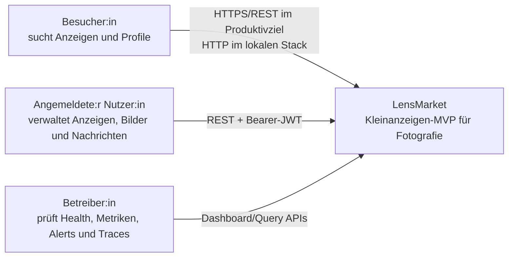
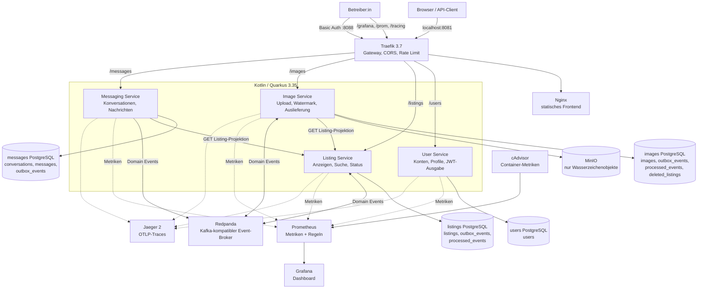
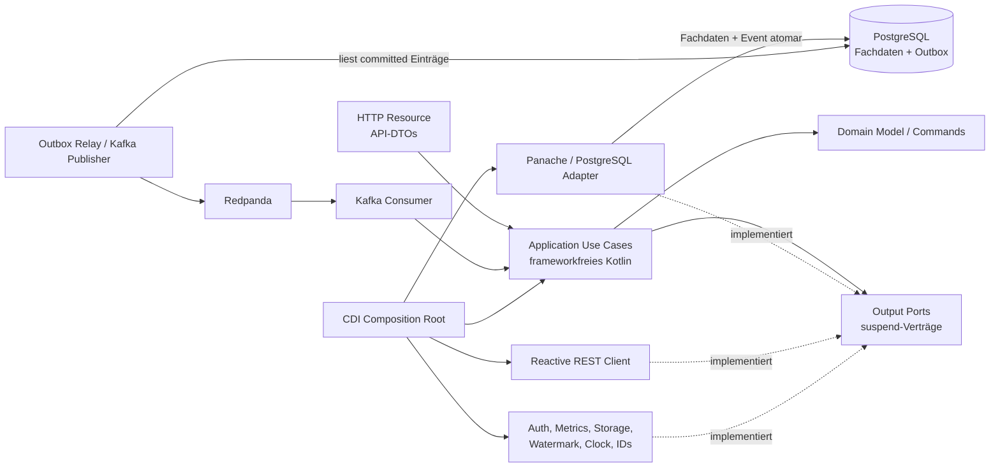
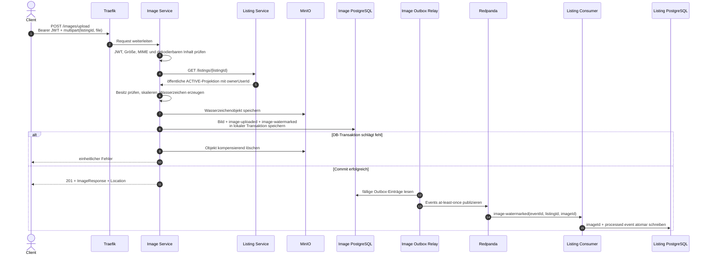
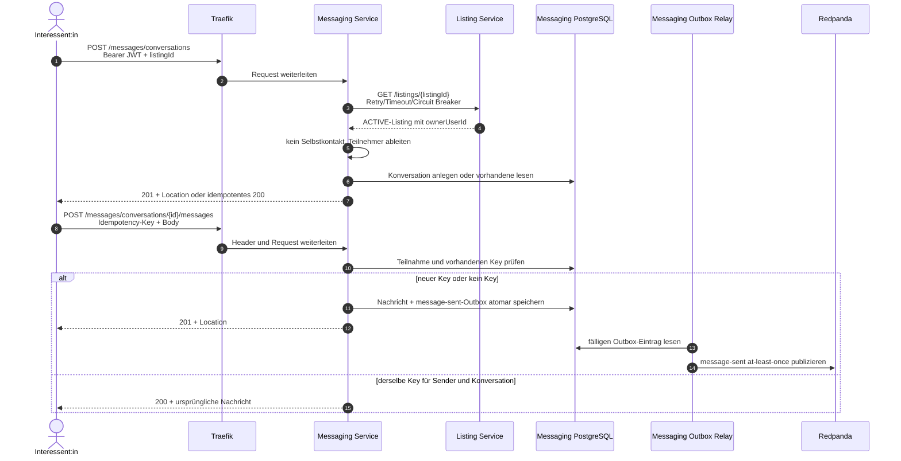

# LensMarket-Architektur

Dieses Dokument ist die zentrale, codegleiche Architektursicht für Entwicklung und Betrieb. Die Diagramme zeigen die lokale Compose-Umgebung.
## Systemkontext

LensMarket ermöglicht Registrierung und Login, öffentliche Profile, Anzeigen und Suche, Wasserzeichen-Bilduploads sowie Konversationen zwischen Interessent:innen und Anzeigenbesitzer:innen. Kauf, Bestellung, Bezahlung, E-Mail-Verifikation und Passwort-Reset gehören nicht zum MVP.

## Container, Services und Datenhoheit

Jeder fachliche Service besitzt ausschließlich seine eigene Datenbank und seine eigenen Flyway-Migrationen. IDs anderer Services sind lose Referenzen; es gibt weder Cross-Service-Foreign-Keys noch direkte Zugriffe auf fremde Datenbanken. Der Image Service besitzt zusätzlich den MinIO-Bucket. Redpanda transportiert Integrationsereignisse, ist aber nicht die führende Datenquelle.

| Service | Führende Daten | Synchron konsumiert | Publiziert | Konsumiert |
|---|---|---|---|---|
| User | Konten, Passwort-Hashes, Profile | – | – | – |
| Listing | Anzeigen, Status, Bild-ID-Projektion | – | `listing-created`, `listing-status-changed`, `listing-deleted` | `image-watermarked` |
| Image | Bildmetadaten, Wasserzeichenobjekte, Listing-Tombstones | öffentliche Listing-Projektion | `image-uploaded`, `image-watermarked` | `listing-deleted` |
| Messaging | Konversationen, Nachrichten, Idempotency-Keys | öffentliche Listing-Projektion | `message-sent` | – |

## Modul- und Dependency-Graph

Alle vier Services verwenden dieselbe Schichtenrichtung. Kafka-Consumer und Outbox Relay kommen nur in den Services mit Domain Events hinzu:

Das äußere Quarkus-Modul hängt vom inneren `application`-Modul ab. Die Gegenrichtung ist verboten. Schreibende Use Cases rufen Repository-Ports auf, deren Adapter Fachdaten und Outbox-Einträge atomar speichern. Das äußere Outbox Relay publiziert ausschließlich bereits committed Einträge und ist kein Application-Port. `architectureCheck` kompiliert die inneren Module und verhindert Framework-Imports, äußere Produktionsdependencies, Resource-Zugriffe an Use Cases vorbei sowie direkte Repository-Zugriffe aus Consumern.

## Sequenz: Bild-Upload und Eventflow

Der HTTP-Erfolg bestätigt die dauerhaft gespeicherten Bilddaten und Outbox-Einträge, nicht die bereits aktualisierte Listing-Projektion. Brokerzustellung ist bewusst eventual consistent und at-least-once; stabile Event-IDs und `processed_events` machen Wiederholungen idempotent.

## Sequenz: Messaging

## Qualitäts- und Betriebsgrenzen

- Authentifizierung ist zustandslos: Der User Service stellt HS256-JWTs aus; alle geschützten Services validieren Signatur, Algorithmus, Issuer, Audience, Zeit- und Pflichtclaims lokal.
- Autorisierung basiert auf Identität, Besitz und Konversationsteilnahme. Das selbst pflegbare Profilfeld `role` verleiht keine Berechtigungen.
- Synchrone Abhängigkeiten existieren nur als sichere Listing-`GET`-Aufrufe. Technische Ausfälle werden nach begrenzten Retries als `503`, Timeouts als `504` sichtbar.
- Schreiboperationen mit Events verwenden lokale Transaktionen und Transactional Outbox; es gibt keine verteilte ACID-Transaktion.
- Prometheus/Grafana liefern Metriken und Alerts, Jaeger 2 Distributed Tracing. Logs enthalten Trace- und Span-IDs, sind derzeit aber bewusst kein JSON.
- Compose bildet eine reproduzierbare lokale Referenzumgebung ab. TLS, Broker-ACLs, asymmetrische/OIDC-Identität, Hochverfügbarkeit und orchestrator-native Secrets wären für einen produktiven Betrieb zusätzlich erforderlich.

Die konkreten API-Verträge stehen unter [`docs/openapi/`](openapi/), die Ausfallsemantik in [`reliability.md`](reliability.md) und der Betriebsablauf in [`operations.md`](operations.md).
